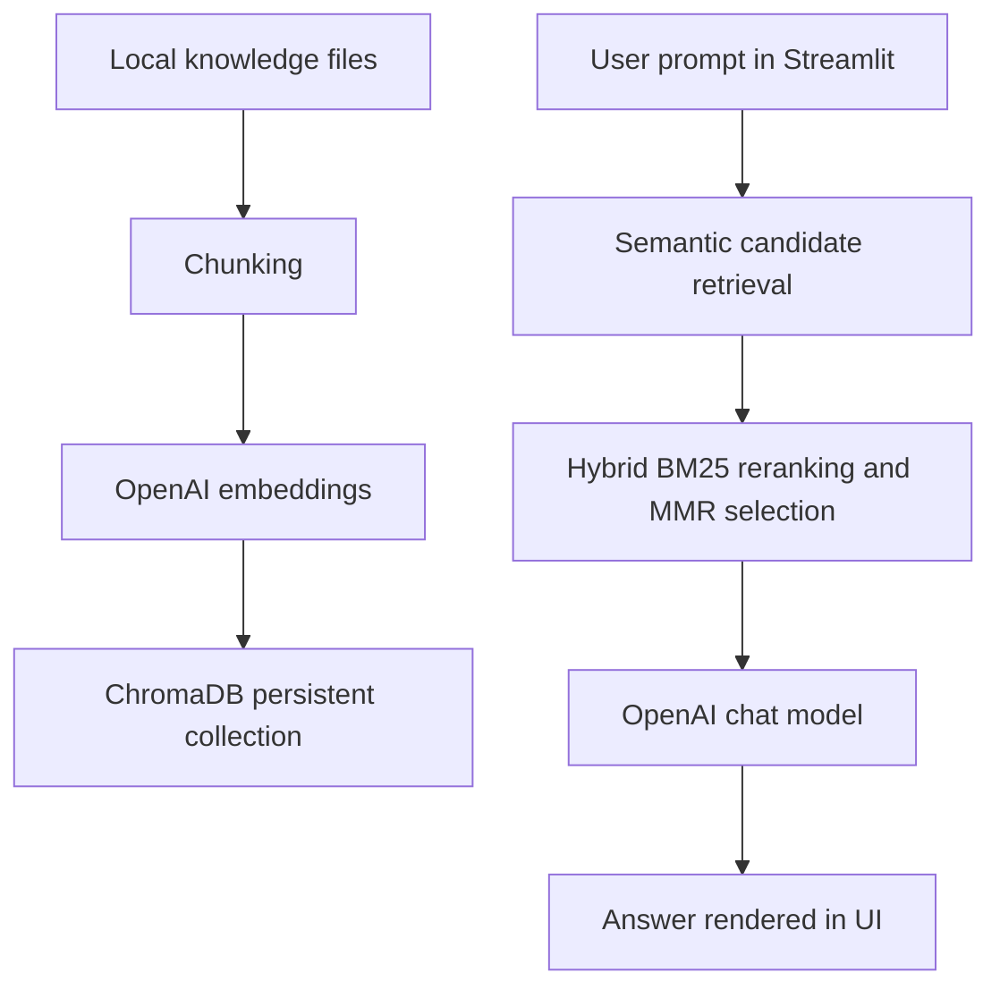

# System Architecture

## Components

- `src/ingest.py` - đọc local knowledge files, chunk theo paragraph/sentence với heading context và overlap, embed, rồi upsert vào ChromaDB.
- `src/query.py` - lấy semantic candidate pool từ ChromaDB, hybrid-rerank bằng semantic score + BM25 lexical score, áp dụng MMR để giảm context trùng lặp, rồi gửi context đã chọn tới OpenAI.
- `src/tools.py` - các helper level cao cho summaries, weekly plans, project reports, và sinh nội dung file bằng AI theo đúng định dạng được yêu cầu.
- `src/agent.py` - simple router chọn tool cần gọi.
- `src/app.py` - Streamlit UI cho chat và quick prompts.

## Luồng dữ liệu

## Storage

- Persistent vector data: `storage/chroma_db`
- Environment config: `.env`
- Source knowledge: `data/knowledge/`

## Ghi chú về behavior hiện tại

- Sidebar quick prompts chỉ prefill input field.
- Nút Send là trigger chạy assistant.
- Chat history hiển thị dưới dạng collapsed expanders.
- File-generation request đi qua generation prompt riêng, không dùng template placeholder; download MIME được chọn theo extension.

## Retrieval configuration

- `RAG_TOP_K`: số chunk cuối cùng đưa vào generation, mặc định `5`.
- `RAG_CANDIDATE_K`: kích thước semantic candidate pool trước reranking, mặc định `20`.
- `RAG_MMR_LAMBDA`: cân bằng relevance/diversity trong MMR, mặc định `0.75`.
- `RAG_CHUNK_SIZE`: kích thước chunk mục tiêu theo ký tự, mặc định `1200`.
- `RAG_CHUNK_OVERLAP`: overlap giữa các chunk theo ký tự, mặc định `180`.
