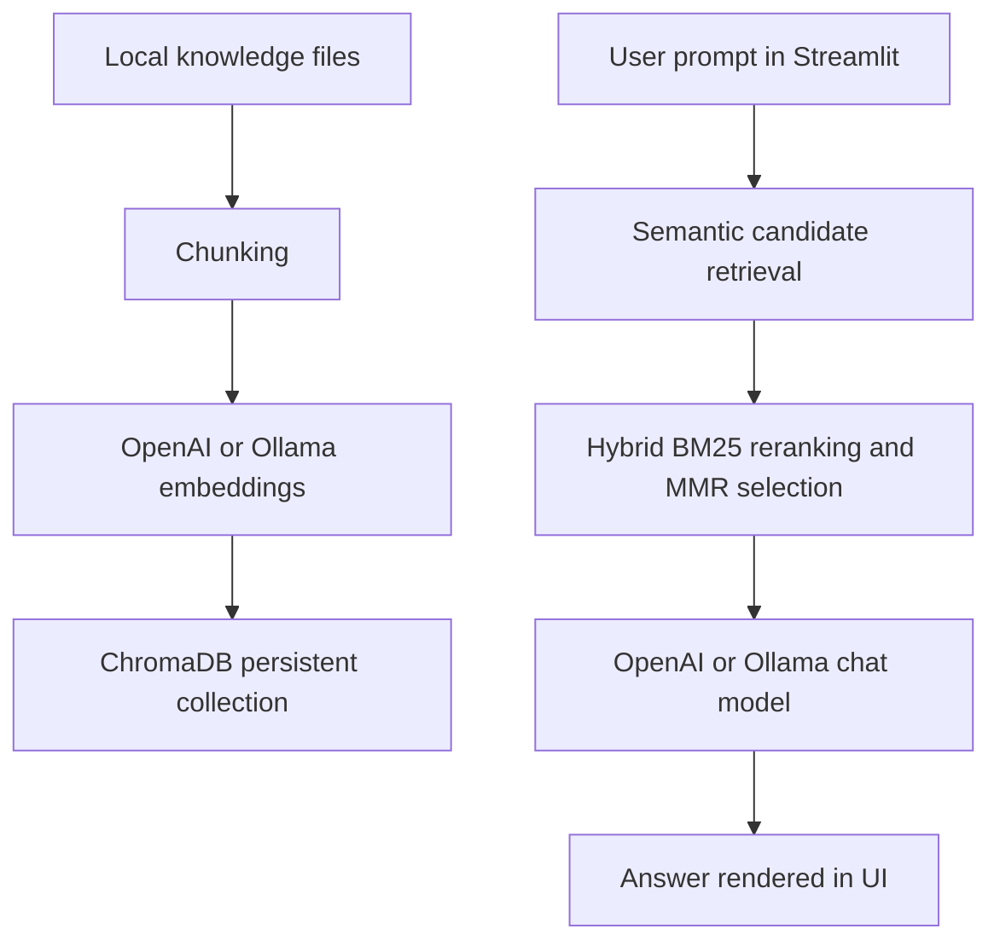

# System Architecture

## Components

- `src/ingest.py` - đọc local knowledge files, chunk theo paragraph/sentence với heading context và overlap, embed, rồi upsert vào ChromaDB.
- `src/model_provider.py` - chọn OpenAI/Ollama client và model cho chat hoặc embeddings từ environment.
- `src/query.py` - retrieval, hybrid rerank và MMR, rồi gửi context tới provider chat đã chọn.
- `src/tools.py` - routing helper cho summaries, reports, text files và binary artifacts.
- `src/artifacts.py` - gọi Images API và dựng workbook XLSX thật từ JSON có cấu trúc do AI sinh.
- `src/agent.py` - simple router chọn tool cần gọi.
- `src/app.py` - Streamlit UI cho chat và quick prompts.

## Luồng dữ liệu

## Storage

- Persistent vector data: `storage/chroma_db`
- Environment config: `.env`
- Source knowledge: `data/knowledge/`

## Ghi chú về behavior hiện tại

- Sidebar quick prompts chỉ prefill input field.
- Nút Send là trigger chạy assistant.
- Các lượt user/assistant gần nhất được gửi lại cho model trong cùng Streamlit session; tối đa 10 messages hoặc 12.000 ký tự.
- Clear chat xóa cả conversation context và generated artifact của session.
- Ảnh được render/tải dạng PNG; Excel được tạo dạng XLSX với header style, filter, freeze panes và column widths.
- Chat history hiển thị dưới dạng collapsed expanders.
- File-generation request đi qua generation prompt riêng, không dùng template placeholder; download MIME được chọn theo extension.

## Retrieval configuration

- `AI_PROVIDER`: provider mặc định (`openai` hoặc `ollama`).
- `CHAT_PROVIDER`, `EMBEDDING_PROVIDER`: override riêng cho từng luồng.
- Đổi embedding provider/model yêu cầu rebuild ChromaDB.

- `RAG_TOP_K`: số chunk cuối cùng đưa vào generation, mặc định `5`.
- `RAG_CANDIDATE_K`: kích thước semantic candidate pool trước reranking, mặc định `20`.
- `RAG_MMR_LAMBDA`: cân bằng relevance/diversity trong MMR, mặc định `0.75`.
- `RAG_CHUNK_SIZE`: kích thước chunk mục tiêu theo ký tự, mặc định `1200`.
- `RAG_CHUNK_OVERLAP`: overlap giữa các chunk theo ký tự, mặc định `180`.
