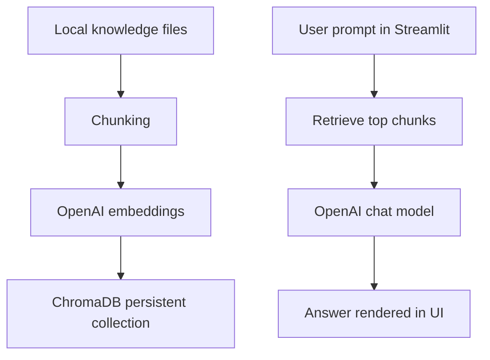

# System Architecture

## Components

- `src/ingest.py` - đọc local knowledge files, chunk chúng, embed chúng, và lưu vào ChromaDB.
- `src/query.py` - retrieve các top matches từ ChromaDB và gửi chúng tới OpenAI để tạo final answer.
- `src/tools.py` - các helper level cao cho summaries, weekly plans, và project reports.
- `src/agent.py` - simple router chọn tool cần gọi.
- `src/app.py` - Streamlit UI cho chat và quick prompts.

## Luồng dữ liệu

## Storage

- Persistent vector data: `storage/chroma_db`
- Environment config: `.env`
- Source knowledge: `data/knowledge/`

## Ghi chú về behavior hiện tại

- Sidebar quick prompts chỉ prefill input field.
- Nút Send là trigger chạy assistant.
- Chat history hiển thị dưới dạng collapsed expanders.
